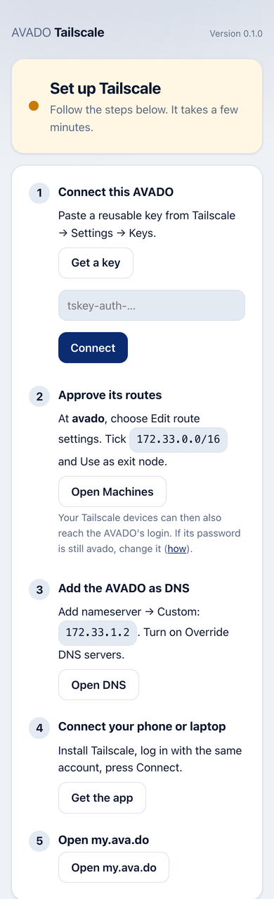
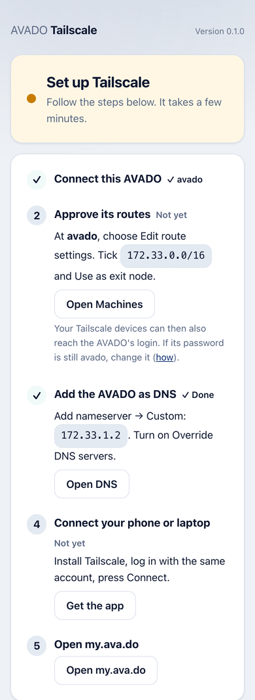
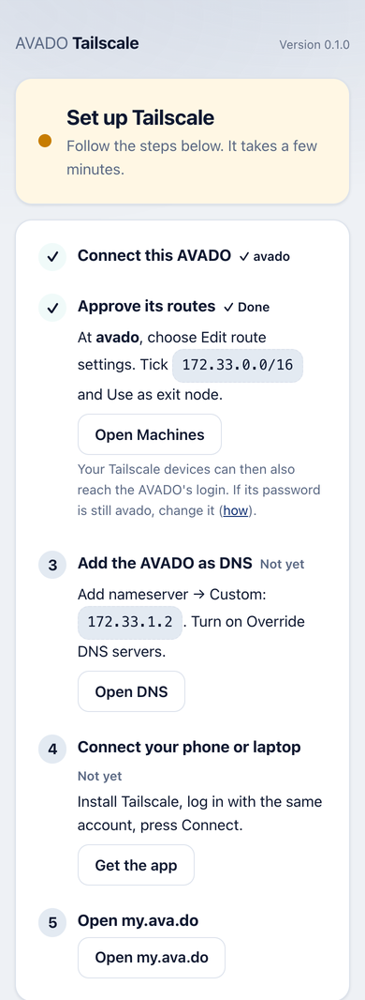
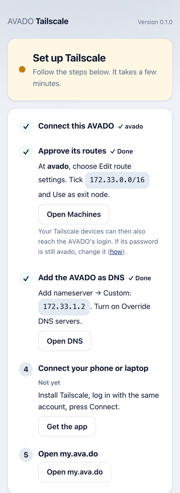
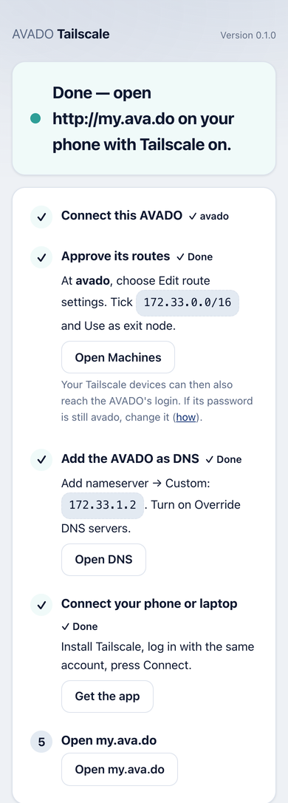

# AVADO Tailscale

`tailscale.avado.dnp.dappnode.eth`: open your whole AVADO from your phone or laptop wherever you
are, with your own free Tailscale account. The AVADO Admin at `http://my.ava.do` and every app open
just like at home. AVADO Remote Access keeps working as before. No AVADO servers, no running cost.

The setup is the same as DAppNode's Tailscale package
([their guide](https://docs.dappnode.io/docs/user/access-your-dappnode/vpn/tailscale/)). The app's
page at `http://tailscale.my.ava.do` shows the steps as a checklist and ticks each one off by itself.

## Set it up in 5 steps

Before you start: make a free account at [tailscale.com](https://tailscale.com).

### 1. Connect this AVADO

In Tailscale, open [Settings → Keys](https://login.tailscale.com/admin/settings/keys) and press
**Generate auth key**. Switch on **Reusable** and copy the key. Paste it in the **Tailscale auth key**
field when you install the app. Forgot it? Paste it on the app's page in step 1 instead.



### 2. Approve its routes

Open [Machines](https://login.tailscale.com/admin/machines). At **avado**, choose **Edit route
settings**. Tick `172.33.0.0/16` and **Use as exit node**, then save.

Your Tailscale devices can then also reach the AVADO's login (SSH). If its password is still
`avado`, change it (see "Who can reach this AVADO" below).



### 3. Add the AVADO as DNS

Open [DNS](https://login.tailscale.com/admin/dns). Choose **Add nameserver → Custom**, enter
`172.33.1.2` and save. Turn on **Override DNS servers**.



### 4. Connect your phone or laptop

Install [Tailscale](https://tailscale.com/download), log in with the same account and press
**Connect**. On a Linux computer: `sudo tailscale up --accept-routes`.



### 5. Open my.ava.do

With Tailscale on, open `http://my.ava.do` on your phone or laptop.



Tip: in Machines, choose **Disable key expiry** for the AVADO. Otherwise Tailscale logs it out after
a few months. The page reminds you of the date.

## More options (on the page, folded away)

- **Log in with a link instead of a key**: the page shows Tailscale's login link and a QR code.
- **DNS only for my.ava.do**: instead of Override DNS servers, switch on **Restrict to domain** and
  enter `my.ava.do`. Your devices then keep their own DNS for everything else.
- **Two AVADOs in one Tailscale account**: both offer the same addresses, so only one works at a
  time. Untick the routes of the one you do not need from afar. The page warns when it sees this.
- **AI Connect through Tailscale**: make AVADO AI Connect reachable from your Tailscale devices at
  `https://avado.<your-name>.ts.net/mcp`, or on the internet for ChatGPT and Claude on the web
  (off by default, asks for confirmation). Only AI Connect's MCP door and its sign-in are shared,
  and only apps you allowed on the AI Connect page (or with one of your AI Connect keys) get in.
- **Log out of Tailscale**.

## Who can reach this AVADO

Every device in your Tailscale account, the same as a device at home: the Admin, the apps and the
AVADO's login (SSH at `172.33.0.1`, user `avado`). Add only your own devices and do not share the
AVADO with other people in Tailscale.

The AVADO's password starts as `avado`. To change it: on a computer with Tailscale on, open a
terminal and type `ssh avado@172.33.0.1`, log in with the current password, type `passwd` and
choose a new one.
Keep it safe: AVADO support asks for it when they help you. (Neither the Admin nor docs.ava.do has a
page for this yet.)

## How it works

Like DAppNode's package, the app runs Tailscale's own container start program (`containerboot`) in
**kernel mode**:

| Setting | Value | Where |
|---|---|---|
| `TS_AUTHKEY` | the reusable key from the installer | manifest (shown in the Admin) |
| `TS_ROUTES` | `172.33.0.0/16` (the AVADO network: Admin, apps, DNS at `172.33.1.2`) | manifest |
| `TS_EXTRA_ARGS` | `--advertise-exit-node` | manifest |
| `TS_DEBUG_FIREWALL_MODE` | `auto` (tailscaled chose nftables on the test box) | manifest |
| `TS_AUTH_ONCE` | `true`: the key is used only while the box is not logged in | image |
| `TS_STATE_DIR` | `/data/tailscale` in the `tailscale` volume | image |
| `TS_USERSPACE` | `false` (kernel mode) | image |
| `TS_BOOT_TIMEOUT` | `1h` | image |
| `TS_HOSTNAME` | `avado` | image |

- Rights: `cap_add: NET_ADMIN, SYS_MODULE` and `/dev/net/tun` as a volume
  (`/dev/net/tun:/dev/net/tun`), because the AVADO DAPPMANAGER's compose generator supports
  `cap_add` and volumes but not `devices`. Docker's default device rules allow the tun device, so
  the app is **not** privileged. IP forwarding is already on inside AVADO containers
  (`net.ipv4.ip_forward=1`), which containerboot needs for the route. tailscaled's firewall rules
  and the `tailscale0` interface live in the container's own network; the box's routes,
  iptables/nftables and ZeroTier Remote Access are not touched (checked on the test box).
- IPv6: AVADO containers have IPv6 off, so Tailscale's health check says "IPv6 forwarding is
  disabled" (DAppNode's package shows the same). IPv4, the route and the exit node work.
- The auth key differs from DAppNode in one way: containerboot does not get it. The page logs in
  with `TS_AUTHKEY` once, while the box is not logged in yet (`TS_AUTH_ONCE`), and hands the key to
  `tailscale up` in a private file that is deleted right after (never on a command line, hidden in
  the app's logs). A rejected key shows a plain message on the page and the login link keeps
  working; DAppNode's package needs the key cleared and a restart for that.
- Two processes (`build/start.sh`): containerboot (root, with the rights above), and the page
  (`node`, as root but with no Linux capability except binding port 80, and `no_new_privs`).
  containerboot stops when a login fails or nobody logs in within `TS_BOOT_TIMEOUT`; start.sh
  starts it again, so the page stays. If the page stops, the app restarts.
- The page reads `tailscale status`, `debug prefs` and `debug netmap` (for the DNS tick) and runs
  only fixed commands: `up` with the same settings as containerboot (key login, login link),
  `logout`, `serve` and `funnel`. The login link shown is only ever a real
  `https://login.tailscale.com/a/...` link (or one on an own login server); other apps reading
  `/api/status` get a short form without it.
- `--accept-dns=false --accept-routes=false` on the box: the container keeps the box's DNS (bind)
  and never takes routes from another AVADO.
- The AI Connect relay (`127.0.0.1:8100`, Serve/Funnel point at it) passes only `/mcp`,
  `/k/<key>/mcp` and the fixed list of AI Connect 0.2.0's sign-in paths (the OAuth documents under
  `/.well-known/`, `/oauth/register`, `/oauth/authorize`, `/oauth/token` and the "Approve on your
  AVADO" waiting page with its files). The query string is kept only for the sign-in paths. The box's
  Tailscale name (the Host Serve answered for) goes along as `X-Forwarded-Host`, replacing any value
  from outside, so AI Connect names its sign-in address correctly. The approval itself happens only on
  the AI Connect page, which the relay never passes on. It finds AI Connect by its container name `DAppNodePackage-mcp.avado.dnp.dappnode.eth`
  (Docker's own DNS answers that only while the container exists; `mcp.my.ava.do` can keep an old
  address after a removal) and first asks that address for `/identity` without the key. Only when
  the answer is AI Connect does it forward the request, to the same address. Otherwise the
  assistant gets "AI Connect is not installed or not running on this AVADO."
- An own control server (Headscale) for tests: `TS_EXTRA_ARGS=--advertise-exit-node --login-server=http://...`.

### Installer field

The manifest has a `"setupWizard"` field for `TS_AUTHKEY`, in the same format as DAppNode's
`setup-wizard.yml` (version 2: `id`, `target` type `environment`, `title`, `description`, `secret`,
`required`). The AVADO Admin from 10.0.70 shows it on the install page as a masked input with a
Show button (Simple and Advanced mode) and sends it with the install call (`userSetEnvs`). With an
older Admin, or when it is left empty, the key goes on the app's page (step 1).

### What comes from DAppNode

`dappnode/DAppNodePackage-tailscale` has no licence file, so it is a reference only and nothing was
copied. Taken over as ideas: containerboot in kernel mode with `TS_ROUTES`, `TS_EXTRA_ARGS=--advertise-exit-node`,
`TS_AUTH_ONCE`, `TS_BOOT_TIMEOUT=1h`, `TS_DEBUG_FIREWALL_MODE=auto`, `NET_ADMIN` + `SYS_MODULE`,
`/dev/net/tun`, the reusable auth key at install, the user guide (approve the route and exit node,
nameserver with Override DNS servers, Linux `--accept-routes`, two-devices caveat), and the
reporter's "only a genuine login link" rule. Not taken: the reporter container (the page reads
tailscaled directly) and their second route `10.20.0.0/24` (AVADO has no such network).

## Build and test

```
cd build/service && yarn install --frozen-lockfile && yarn lint && yarn test   # Node 22
docker buildx build --platform linux/amd64 --load -f build/Dockerfile -t tailscale.avado.dnp.dappnode.eth:0.2.0 .
```

End to end without a Tailscale account (as on the test box): run Headscale next to the box with a
global nameserver `172.33.1.2` and `override_local_dns: true`, install the app through the
DAPPMANAGER with `TS_AUTHKEY` (a reusable Headscale key) and
`TS_EXTRA_ARGS=--advertise-exit-node --login-server=http://<headscale>`, approve
`172.33.0.0/16,0.0.0.0/0,::/0` with `headscale nodes approve-routes`, and run a second tailscaled as
the "phone" in its own Docker network with `--accept-routes --accept-dns`. Serve/Funnel need real
Tailscale (Headscale has no HTTPS certificates).
